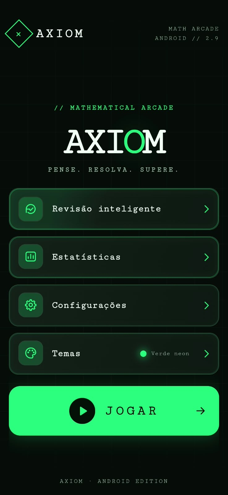
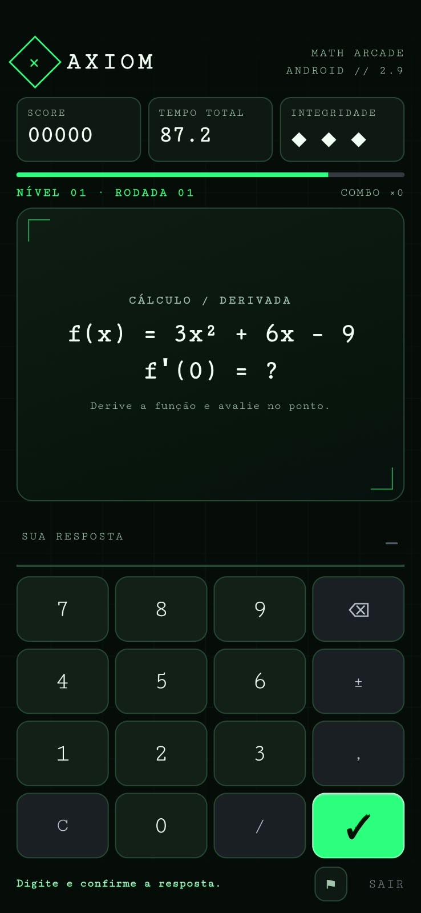
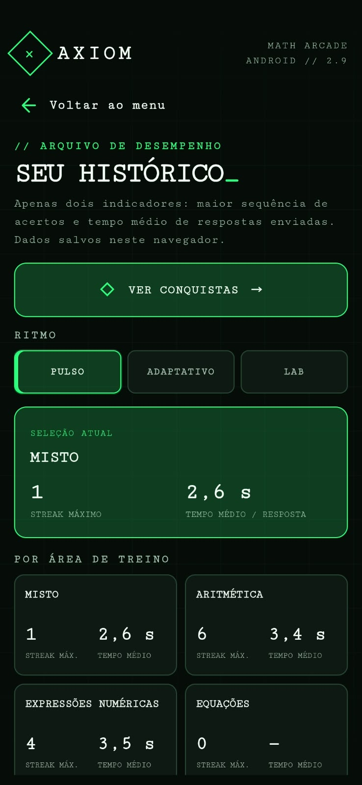
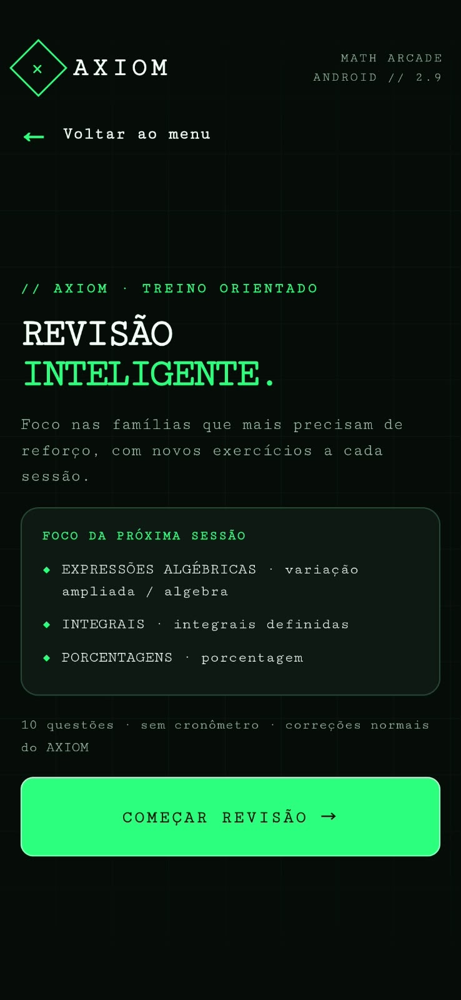

# AXIOM — Math Arcade

**Aplicativo Android de treinamento matemático e raciocínio lógico.**

## Sobre o projeto
## Demonstração do aplicativo

### Menu principal

### Modos de jogo

### Estatísticas

### Revisão inteligente

O AXIOM é um aplicativo Android desenvolvido de forma independente, com o objetivo de transformar a prática matemática em uma experiência dinâmica, acessível e interativa.

O projeto combina conceitos matemáticos, algoritmos e desenvolvimento de software para oferecer diferentes modalidades de exercícios, acompanhamento de desempenho e treinamento personalizado.

## Funcionalidades

- Mais de 20 modos de jogo matemáticos.
- Sistema de dificuldade adaptativa baseado no desempenho do jogador.
- Modo Rush, com desafios de velocidade.
- Revisão inteligente de conteúdos.
- Treinamento personalizado.
- Desafios diários.
- Estatísticas de desempenho, incluindo sequências de acertos e tempo médio.
- Sistema de conquistas.
- Backup local de progresso.

## Tecnologias utilizadas

- **JavaScript:** lógica de programação, geração de questões e gerenciamento do jogo.
- **HTML5:** estrutura da interface.
- **CSS3:** estilização e adaptação visual.
- **Capacitor:** integração da aplicação web com Android.
- **Android Studio:** compilação, testes e geração do aplicativo Android.

## Aspectos técnicos

O desenvolvimento do AXIOM envolve a implementação de algoritmos matemáticos para geração de exercícios, validação de respostas, gerenciamento de estados e adaptação da dificuldade.

O projeto também contempla organização da interface, persistência local de dados, depuração e testes em dispositivos Android.

A dificuldade adaptativa utiliza regras programadas, não modelos de machine learning.

## Status

Projeto funcional, em desenvolvimento contínuo, com novas funcionalidades planejadas para futuras versões.

Este repositório apresenta a documentação do aplicativo. O código-fonte não está disponibilizado publicamente.

## Desenvolvedor

**Danilo Gabriel**

Graduando em Licenciatura em Matemática pela Universidade Federal Rural de Pernambuco (UFRPE).

Interesses em desenvolvimento de software, matemática aplicada à computação e inteligência artificial.
